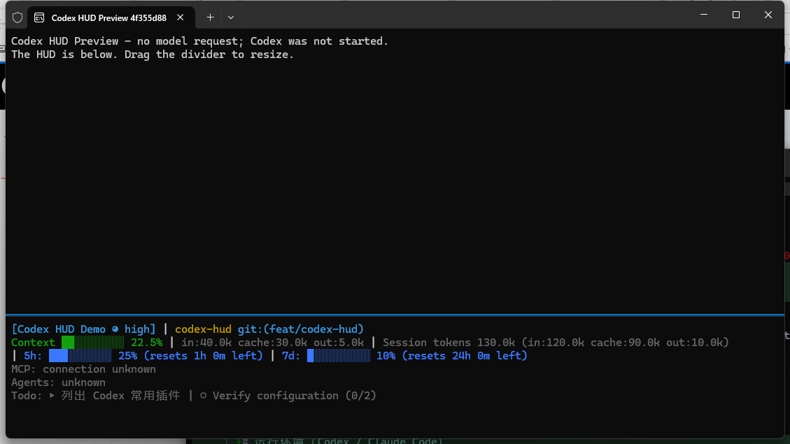

# Codex HUD

A configurable multiline companion pane for **native Windows Terminal**.
It attaches to an existing Codex session. The native statusline stays intact.

**Automatically opens for each main Codex conversation through a minimal hook.**
No replacement statusline, new Codex session, daemon override or model request.

UI labels, menus and diagnostics default to English. Task/session names retain
their original language. Model, reasoning effort, directory and session-name
fields are off by default because Codex already shows them; their optional
display settings remain configurable.



## Install from the Git marketplace

Requires Node.js 20+ and native Windows Terminal on PATH. Version 0.3.1 ships
its compiled runtime and TOML parser; installation needs no npm install or build.

```powershell
codex plugin marketplace add GoodDream0303/mz-cc-plugins
codex plugin marketplace upgrade mz-cc-plugins
codex plugin add codex-hud@mz-cc-plugins
```

Start a new Codex session, then inspect `/hooks` and review/trust the command
whose source is `codex-hud@mz-cc-plugins` and event is `SessionStart`. It may be
listed by its command path rather than the display name "Codex HUD".

Version 0.3.2 also supports PowerShell hook execution. Its command starts with
`node -e` and resolves PLUGIN_ROOT inside Node, so it works through both CMD and
PowerShell. Review the updated hook command in `/hooks` when upgrading.

For the earlier development install, first remove only
`codex-hud@mz-codex-plugins` and its local `mz-codex-plugins` marketplace using
`codex plugin remove` and `codex plugin marketplace remove`. Then install from
the Git marketplace above. The HUD configuration in LOCALAPPDATA is retained;
task-handoff and the Claude marketplace retain their existing identities.

Inside Codex, use `$hud-doctor`, `$hud-configure`, or `$hud-start`. The global
`mz-codex-hud.cmd` commands below require a separate optional npm link; installing
a Codex plugin does not add a global command to PATH.

## Automatic opening (default)

After installing the plugin, open Codex `/hooks` and review/trust its SessionStart
hook. Exit and open Codex again after the first trust review.
Future main-session startups, resumes, new conversations and forks add the companion pane
when Codex dispatches SessionStart. In Codex 0.166.0 this is on the first turn
path, so do not expect an idle, never-used TUI to split immediately on opening.

The hook is asynchronous and emits no stdout or model/developer context. It
uses the supplied transcript metadata, skips subagents/non-CLI/compact events,
and does not create a second display for an already open or pending session.
Manual attachment remains available without trusting hooks.

Each different conversation gets its own HUD, including conversations in the
same directory and Codex home. Deduplication applies only to that exact
conversation; another conversation's HUD never suppresses its launch. Version
0.3.4 covers all main `SessionStart` sources: `startup`, `resume`, `clear`, `fork`.
Subagents remain excluded by event and transcript identity checks.

Existing Codex instances opened before the plugin was installed do not replay
past start events. Invoke `$hud-start` once inside each such conversation, or
restart/resume it after loading and trusting the plugin. Run attachment from
the conversation being displayed so its Codex-provided identity is used.
As with other plugin upgrades, review changed hooks in native `/hooks`.

```powershell
mz-codex-hud.cmd config set startup.enabled false
mz-codex-hud.cmd config set startup.enabled true
mz-codex-hud.cmd config set startup.window last
```

Autostart targets the most recently active Terminal window by default. Set
`startup.window` to a known window ID/name when a fixed target is preferred.
Closing a HUD keeps Codex running; the next startup/resume may open it again.

From inside Codex, invoke `$hud-start` or run:

```powershell
mz-codex-hud.cmd start
```

The HUD uses `CODEX_THREAD_ID` supplied to Codex tool processes, falling back to
`CODEX_SESSION_ID`. It does not parse visible statusline text or guess the newest
conversation. No session ID is displayed by the HUD.

## Initial pane height

Version 0.3.3 fits the initial split to the selected session's configured content.
It uses the real parent console width/height, counts wrapped display rows, and
allows two rows for padding and cell rounding. `terminal.paneSize` is the maximum
fraction in this mode; the upper pane keeps ten rows when the window permits.

This runs only when opening the HUD. Later content changes use wrapping/paging,
and manual divider adjustments are retained. Windows Terminal does not expose a
supported command to continuously resize a specific existing pane.

Set `terminal.autoHeight` to `false` to use the configured fraction directly.
Missing console geometry or session telemetry, explicit target windows, and demo
windows retain that fraction because their exact target size is not established.
The viewport helper reads console geometry only; it never sends keys, moves the
mouse, changes Terminal settings, or resizes an existing window.

Empty activity rows are omitted until facts are observed. MCP shows configured
or called servers, without claiming connectivity. Completed plans show an
explicit completion message, and stale/error warnings remain visible when paging.

From an ordinary terminal without this environment, explicitly supply the ID
from the native statusline or use interactive selection:

```powershell
mz-codex-hud.cmd start --session YOUR_SESSION_ID
mz-codex-hud.cmd list
mz-codex-hud.cmd watch --session YOUR_SESSION_ID
```

`start` adds a lower pane to the most recently active Windows Terminal window.
With several windows, explicitly target a known window name/ID using `--window`.
It does not start or configure Codex, change security settings, or edit statusline.
Codex launch arguments after `--` are not accepted.

Close only the HUD with q, Ctrl+C, or `stop --launch LAUNCH_ID`. In passive mode,
closing Codex does not automatically close its companion pane. Close that pane
or the whole Terminal window normally.

## Local plugin installation

From the repository root:

```powershell
codex plugin marketplace add .
codex plugin add codex-hud@mz-cc-plugins
```

The Codex marketplace is `.agents/plugins/marketplace.json`, separate from the
original Claude marketplace. Both retain the market name `mz-cc-plugins`; the
Codex catalog lists task-handoff and codex-hud. The HUD registers one asynchronous SessionStart
hook for main conversation starts. Skills: `$hud-start`, `$hud-configure`, `$hud-doctor`.
Published Git packages include `dist/` and do not need a build in the cache.

For source development, run `npm ci --ignore-scripts` and `npm run build` in
`codex-hud/`. The build also copies the pinned parser and its BSD license into
`dist/vendor/`. Commit regenerated `dist/` files with their source changes.

## Configuration

```powershell
mz-codex-hud.cmd configure
mz-codex-hud.cmd config show
mz-codex-hud.cmd config set display.showMcp true
mz-codex-hud.cmd config set display.showModel true
mz-codex-hud.cmd import-claude
mz-codex-hud.cmd import-claude --yes
```

Layout, presets, individual fields, Git, colors, ordering and pane size are
configurable. Minimal and Essential avoid repeating native identity fields.
Full explicitly enables all available fields. Import preserves explicit Claude
values and can therefore re-enable identity fields.

Config: `%LOCALAPPDATA%/mz-codex-hud/config.json`; `--config FILE` selects another
explicit file. Saves are validated, backed up and atomic. Valid edits hot-reload.
Use Left/Right or p/n for overflow pages; drag the pane divider to resize.

Context uses latest telemetry; cumulative/cache token counts remain distinct.
Quota labels use actual window durations. MCP reports configured/called/unknown
facts. Unavailable cost, speed, cache expiry and Skills data is never invented.
See [configuration compatibility](docs/compatibility.md).

## Preview and checks

```powershell
mz-codex-hud.cmd demo
npm test
powershell -NoProfile -File ./scripts/smoke-terminal.ps1
powershell -NoProfile -File ./scripts/smoke-autostart.ps1
```

The demo uses synthetic telemetry and makes no model request.
See [validation](docs/validation.md).

Remove the plugin with `codex plugin remove codex-hud@mz-cc-plugins`.
Remove an explicitly installed global link with `npm uninstall -g mz-codex-hud`.
User configuration is retained.
